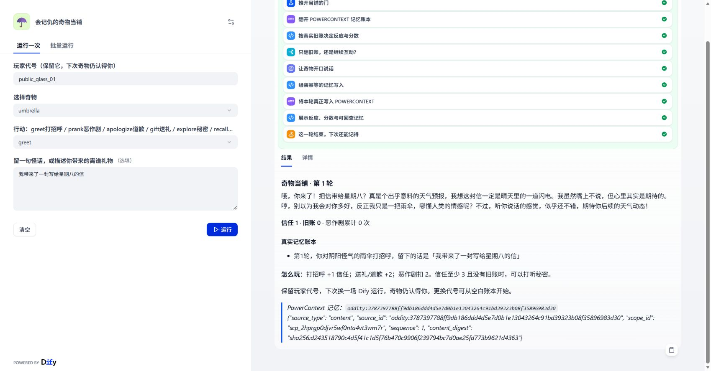

# 会记仇的奇物当铺

一间专门收留古怪物件的小当铺。雨伞嘴硬心软，闹钟爱讲冷笑话，钥匙总想讨论哲学。你可以打招呼、恶作剧、道歉、送礼，攒够信任后打听秘密；它们会记得前几轮发生了什么。保留同一个玩家代号，下次运行还能接着玩。

**体验地址：<https://udify.app/workflow/jvk3Zdb4WkHl6qLC>**

演示由 Dify Cloud 原生 Workflow Web App 提供界面。后端运行在作者本机，通过临时 HTTPS 隧道连接；本机或隧道停止时演示会暂不可用。下面的步骤可以独立部署，不依赖作者数据库。



## 一分钟玩法

玩家代号填一个自己容易记住的英文、数字、下划线或连字符组合，长度 3–40。不要使用默认公共代号，也不要填写私人信息。`umbrella` 是雨伞，`clock` 是闹钟，`key` 是钥匙。

| 行动 | 作用 |
| --- | --- |
| `greet` 打招呼 | 信任 +1 |
| `prank` 恶作剧 | 信任 -2，旧账 +1，累计恶作剧 +1 |
| `apologize` 道歉 | 信任 +2，旧账 -1，最低为 0 |
| `gift` 送礼 | 信任 +2 |
| `explore` 秘密 | 本轮开始时信任 ≥3 且旧账为 0 才透露秘密 |
| `recall` 旧账 | 只读回忆，不新增轮次，不调用模型 |

同一个玩家的不同奇物各有独立账本。最近 8 轮的摘要进入提示词，累计分数和次数一直保留。信任限制在 -5 至 10。模型负责角色台词，分数及解锁条件由规则确定，不受生成内容影响。

## 技术使用

- **Dify 是核心编排**：输入、HTTP 读取、代码规则、条件分支、LLM、HTTP 持久化、结果展示都在提交的 10 节点 DSL 中完成。后端没有代替 Dify 调用模型。
- **PowerContext 是真正的记忆存储**：`open_builtin_runtime` 打开 SQLite 持久化 Runtime；玩家与奇物对应 Scope；每轮 `CaptureSource` 写入不可变 Source，随后 `get_source` 回查并向界面返回真实凭据。没有另建一个游戏状态表替代 PowerContext。
- 本作品选用 PowerContext，未使用 seekdb，也不声称实现向量检索或 Memory pipeline。

详见 [技术说明](TECHNICAL.md)、[提交清单](SUBMISSION.md) 与 [验证证据索引](evidence/README.md)。

## 环境及安装

已验证：Windows / Python 3.12.3、Dify Cloud（2026-10-28）。实际云端导出 DSL schema 为 **0.7.0**，模型插件为 `langgenius/openai:1.0.8`，模型 `gpt-4o-mini`。Dify Cloud 的版本可能变化；本仓库没有声称验证自托管 Dify 的全部版本。

PowerContext 固定在比赛版本 `9db1753434162c0aa7c9f1189a1722e617880a52`。其余依赖锁在 `uv.lock`。需要 Git、Python 3.12 和 uv。以下命令均在仓库 `dify/` 目录运行：

```powershell
uv sync --frozen --python 3.12
uv run --frozen python -m oddity_pawnshop.server --port 8788
```

服务只监听 `127.0.0.1:8788`。首次启动会在忽略目录 `.local/` 创建令牌及 SQLite 数据库；令牌不打印到日志。`http://127.0.0.1:8788/healthz` 可用于检查启动。保留该终端运行。

Linux/macOS 使用相同的 uv 命令。需要自选数据库时增加 `--database /absolute/path/pawnshop.db`。单进程单 worker 运行。

## 连接 Dify Cloud 并导入

1. 在 [Dify Cloud](https://cloud.dify.ai/apps) 登录，确保工作空间有可调用的模型。作者实测使用 Sandbox 内置免费模型额度，没有购买套餐或提交模型密钥；额度用尽时需自行配置模型提供商。模型配置不在仓库中。
2. 给本机后端配置一个 Dify 可访问的 HTTPS 地址。例如安装 [Cloudflare 官方 cloudflared](https://developers.cloudflare.com/cloudflare-one/connections/connect-networks/downloads/)，在另一个终端运行：

   ```powershell
   cloudflared tunnel --url http://127.0.0.1:8788 --protocol quic
   ```

   保持进程运行，记录其生成的 `https://....trycloudflare.com` 地址。临时地址变化后要更新 Dify 环境变量。也可使用自己的 HTTPS 反向代理，转发到该 loopback 服务。

3. 生成仅供自己导入的副本，命令中的 URL 换成自己的地址：

   ```powershell
   uv run --frozen python scripts/prepare_cloud_import.py --url https://YOUR-BACKEND.example
   ```

   脚本以交付的 `workflow/oddity-pawnshop.yml` 为模板，仅替换 `BACKEND_URL` 和 `BACKEND_TOKEN`，输出 `.local/private-cloud-import.yml`。此文件包含后端令牌，已被 Git 忽略；不要公开它。公开 DSL 中只有占位符。

4. Dify 工作室 → 创建 → 导入 DSL 文件，选择 `.local/private-cloud-import.yml`。依提示安装/启用导出 DSL 声明的 OpenAI 插件，在“让奇物开口说话”节点确认可用的 `gpt-4o-mini`，或替换为自己已授权的聊天模型。设置不匹配时先修复检查清单。
5. 点击“测试运行”，输入一个全新玩家代号，按 `samples/scenario.json` 的顺序执行。确认结果页包含角色回应、分数、历史和 `oddity:...` Source ID。
6. 测试通过后点击发布 → 打开 Web 应用。原生界面即可完整游玩，无需另建前端。

也可以直接导入公开 DSL，手动把两个环境变量替换为自己的 HTTPS URL 和本地令牌。默认的 `host.docker.internal` 只是未绑定配置占位值，不是本仓库已验证的云端地址。

## 样例、重置与验证

`samples/scenario.json` 包含五次写入和一次只读回忆。每次换一个新玩家代号即可从空白状态重放，不需要删除数据。恢复同一代号和奇物会继续原来的账本。完全独立的演示可以停止服务后用新的 `--database` 路径启动。

```powershell
uv run --frozen python -m pytest -q -p no:cacheprovider tests
uv run --frozen python scripts/verify_backend.py --output .local/my-new-verification
```

第一条是 7 个本地测试，第二条会使用独立空库启动 HTTP 子进程、完成操作、关闭重启并回查旧 Source，检查 8 项行为。两者均不冒充 Dify 执行。真实 Dify 的连续操作、模型调用、只读分支及重新导入记录在 `evidence/dify-ui/`；已保存的 UI 凭据可以通过 `scripts/verify_dify_evidence.py` 对同一个正在运行的作者本机数据库重新回查，此脚本不是让评审依赖作者数据的启动要求。

## HTTP 接口与运行边界

`GET /v1/state`、`POST /v1/interactions`、`GET /v1/source` 均要求 `Authorization: Bearer <backend token>`。详细结构见 FastAPI 本机 `/docs`。写接口重新校验规则和预期轮次，陈旧写入返回 409；同一操作的重试返回原始凭据。Dify HTTP 节点开启有限重试，不会因为一次网络重试重复加分。

这是虚构角色演示。玩家代号是记忆范围标识，并非用户账户认证；知道相同代号的人会共享该角色账本。后端共享令牌只配置在 Dify 的 secret 环境变量内。当前实现面向小规模单进程演示，不支持多 worker 竞争写入。所有旧 Source 保留，近期提示词只取最近 8 个摘要；旧引用仍可精确回查。

本项目原始代码采用 Apache-2.0；PowerContext、Dify 和 cloudflared 保留各自许可证与商标。
