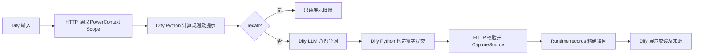

# 技术说明

## 创意与完整交互

“会记仇”由实际跨次状态变化构成：玩家恶作剧后，下一轮的角色提示会带上那次事件，旧账增加；道歉可以消除旧账，但累计恶作剧仍在。送礼改变信任，进而改变秘密是否可见。只读回忆不消耗模型额度、不增加轮次。三件物品各有个性和独立记忆。界面直接展示账本及 Source 凭据，使变化可观察、可解释、可回查。

## 数据路径

Dify 的代码节点嵌入与后端完全相同的纯规则；后端再次计算并校验拟提交状态，防止模型或错误节点改变分数。未解锁时从提示中移除 `secret`。模型失败时使用确定性角色回应，但仍经过真实持久化流程；实际保存的 Dify 跟踪证明验证时调用了模型，未将降级回应当作模型调用证明。

## PowerContext 持久化

使用冻结 SDK 的 `open_builtin_runtime(BuiltinConfig(database=SQLiteConfig(...)))`。`runtime.scopes.create(ScopeDraft(..., idempotency_key=...))` 使同一玩家与物品在重启后仍定位同一 Scope。每次写入调用 `runtime.sources.for_scope(scope_id).capture(CaptureSource(...))`，随后 `runtime.records.for_scope(scope_id).get_source("content", source_id)` 读取实际记录。

Source 内容保存完整状态快照、生成台词、业务指纹和上一轮凭据；metadata 保存玩家代号、物品和轮次。没有独立的旁路游戏表。读取通过 scoped `list_sources` 分页寻找最新位置。界面凭据包含 `source_type`、`source_id`、`scope_id`、`sequence` 和 `content_digest`，均取自真实记录；它是 Source receipt，不冒称 MemoryCitation。

身份由玩家、物品、动作、留言和预期轮次的规范 JSON SHA-256 构成；相同写入的网络重试返回同一 Source。当前轮次不符时拒绝陈旧更新。按玩家和物品的进程内锁防止单 worker 同时提交相互覆盖，多 worker/分布式事务不在当前演示能力内。

## 验证与证据范围

本地测试验证真实 SDK 的重启、幂等、陈旧提交、授权和 Scope 隔离，以及 DSL 序列化和交付导出代码一致性。HTTP 验证另外启动子进程，使用全新数据库进行五轮写入、重启和旧引用回查。两种检查不声称运行 Dify。

Dify Cloud 实际运行采用主应用五次写入、一次只读回忆；第二轮后停止并重新启动同一后端数据库，第三轮仍读取此前事件。第五轮跟踪显示 9 个成功节点和 1062 tokens；只读回忆显示 5 个节点、0 tokens，状态保持第五轮。原生公开 Web App 另用一个新玩家执行成功。

从云端导出当前已保存 DSL，不导出 secret 值，公开版本以占位符替换部署 URL 和令牌。将该文件只绑定新环境变量和应用名，导入为第二个 Dify 应用；使用全新玩家、闹钟角色真实运行，再精确回查其 PowerContext 记录。证据索引及机器可读回查结果见 `evidence/`。

这些是本作品的复现和运行证据，不是组织方评分结果，也不保证最终分数。模型措辞具有随机性；规则、分数、轮次和引用应一致。
