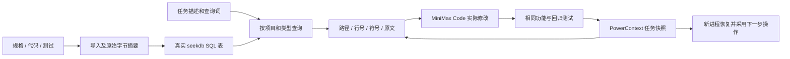

# 一页技术说明：规有所依

**任务**：为任务看板添加精确状态筛选。`demo/before` 是可运行的原始业务，
`demo/after` 是 MiniMax 的公开回复产生的完整快照；同一组测试分别验证两者。

**资料与选择**：`project.json` 声明材料范围。导入时先验证全部 UTF-8 文件与根目录边界，
再用事务替换指定项目资料。`sdd_materials` 保存相对路径、类型、SHA-256 和完整原文。
参数绑定的 SQL 按任务词项出现数排序，每类最多两条；查询结果直接进入开发上下文。
Python AST 给出符号位置，规格标题给出条目 ID。返回前核对源文件存在、字节摘要及全文一致。
没有将样例预期来源清单用于检索；该清单只用于独立验收。

**模型参与**：实际会话使用官方 MiniMax Code 网页，界面选择 M3.1-Flash default。
保存了提交给模型的完整上下文、公开 JSON 回复和可见开发截图。
补丁应用器仅接收 `taskboard/service.py`，先做语法和上下文摘要校验；禁止修改测试。
before/after 文件摘要与模型记录对应，重放程序核对 after 内容与公开回复一致。
没有将模型私有推理或浏览器凭据加入材料。

**任务记忆**：PowerContext 官方冻结提交作为真实依赖。项目/任务对应稳定 Scope，
每次状态快照作为 CAPTURED Content Source 保存，身份为规范化内容摘要，相同写入幂等。
通过公开 records API 分页读取最近状态。独立进程恢复后，已有验证结果和 `next_action`
进入上下文，已完成任务不再要求重新生成。规格或产出源码摘要变化时，旧验证不再标记为有效。

**验证**：before 的目标测试 15 失败、回归 4 通过；MiniMax after 的目标 15 通过、回归 4 通过。
相同测试文件的 SHA-256 在两阶段一致。4 项真实后端集成测试检查查询和来源、项目隔离、
新进程状态恢复、规格重新导入及删除来源。`verify_demo.py` 从新项目/空状态重放完整流程，
记录命令、退出码、代码及测试指纹；不存在用依赖错误代替功能失败的情况。

**部署与限制**：Python 3.12 + uv 固定依赖；seekdb D0 通过 TLS 连接，初始化可创建新实例，
凭据只放在忽略的 `.local/`。重放无需模型重新生成，也不依赖作者实例未到期。
范围是小型工程的文件级词项检索与单写入者任务快照；未声明生产规模或通用检索准确率。
